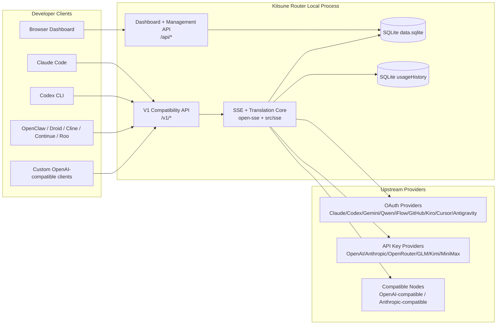
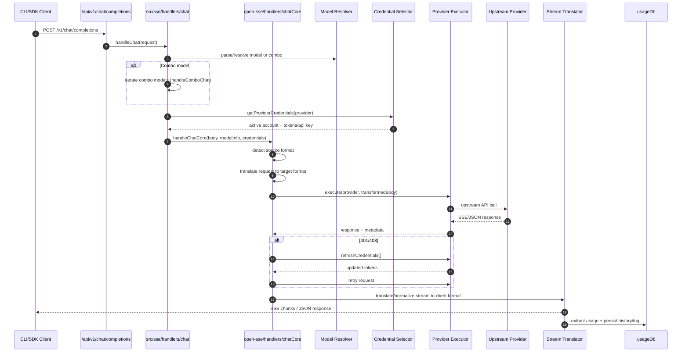
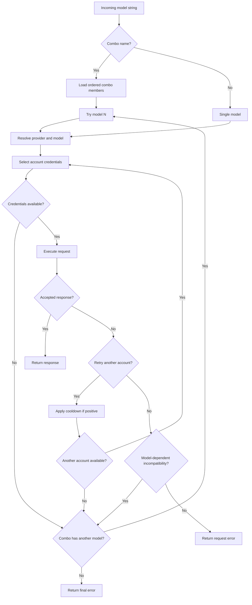
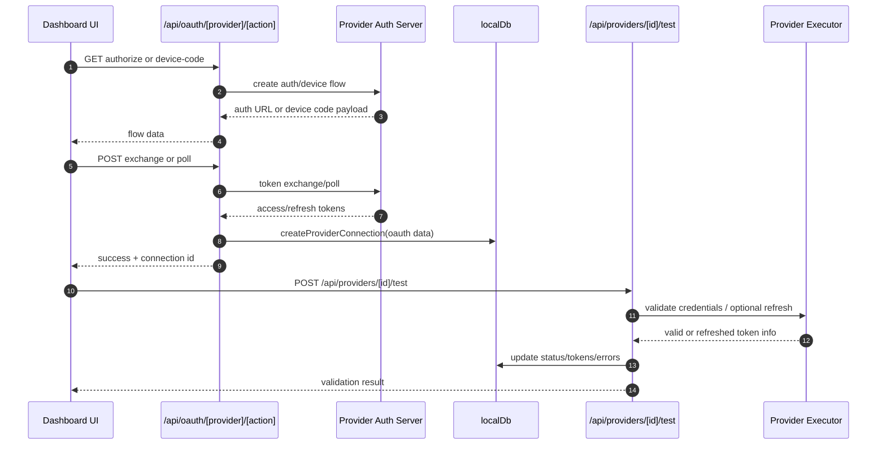
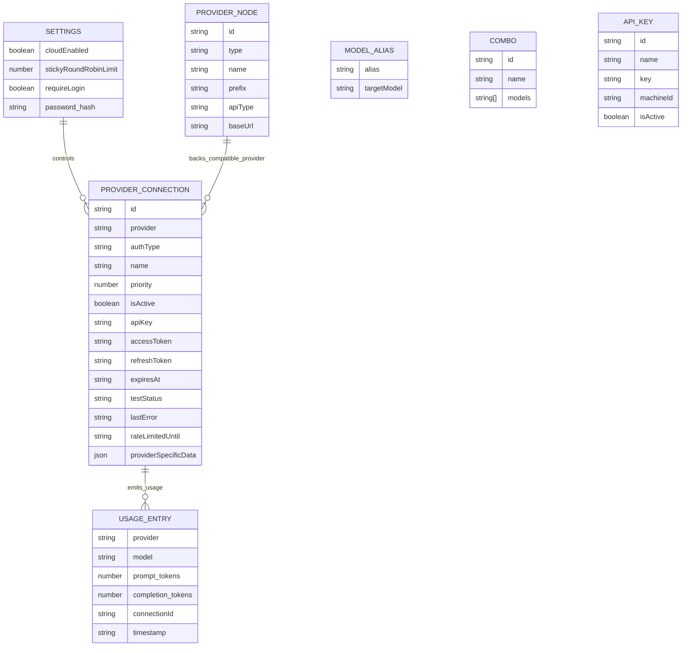
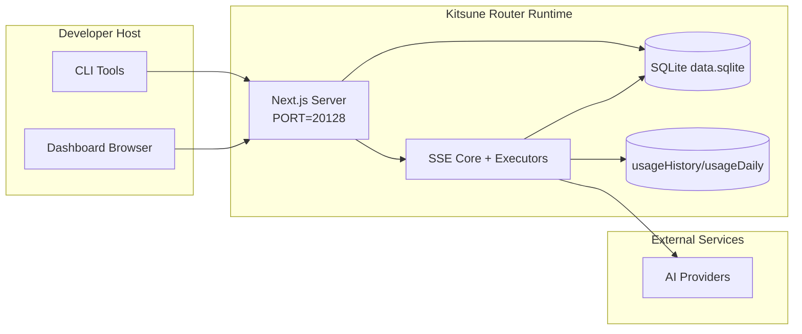

# Kitsune Router Architecture

_Architecture review: 2026-10-19; release guidance updated for the pending 1.0.1 candidate._

**Kitsune Router — Your models. Your routes.** Maintained and sponsored by [ByKitsune](https://bykitsune.com), without a mandatory account or provider order. The 1.0.1 candidate is pending final tag/SHA verification and publication; v1.0.0 is an immutable failed publication attempt, not an available npm/GHCR release. Historical checks below describe their original scope. See [release status](CHANGELOG_v1.0.1.md), [installation](INSTALLATION.md), [migration](MIGRATION.md) and [client integration contracts](INTEGRATIONS.md).

## Executive Summary

Kitsune Router is a local AI routing gateway and dashboard built on Next.js.
It provides a single OpenAI-compatible endpoint (`/v1/*`) and routes traffic across multiple upstream providers with translation, fallback, token refresh, and usage tracking.

Core capabilities:

- OpenAI-compatible API surface for CLI/tools
- Request/response translation across provider formats
- Model combo fallback (multi-model sequence)
- Account-level fallback (multi-account per provider)
- OAuth + API-key provider connection management
- Local persistence for providers, keys, aliases, combos, settings, pricing
- Usage/cost tracking and request logging
- Optional tunnels for access to the same local gateway instance

Primary runtime model:

- Next.js app routes under `src/app/api/*` implement both dashboard APIs and compatibility APIs
- A shared SSE/routing core in `src/sse/*` + `open-sse/*` handles provider execution, translation, streaming, fallback, and usage

## Scope and Boundaries

### In Scope

- Local gateway runtime
- Dashboard management APIs
- Provider authentication and token refresh
- Request translation and SSE streaming
- Local state + usage persistence
- CLI packaging and optional tunnel lifecycle

### Out of Scope

- Legacy cloud-sync implementation (removed; residual URL/settings fields are not a scheduler)
- Provider SLA/control plane outside local process
- External CLI binaries themselves (Claude CLI, Codex CLI, etc.)

## High-Level System Context



## Core Runtime Components

## 1) API and Routing Layer (Next.js App Routes)

Main directories:

- `src/app/api/v1/*` and `src/app/api/v1beta/*` for compatibility APIs
- `src/app/api/*` for management/configuration APIs
- Next rewrites in `next.config.mjs` map `/v1/*` to `/api/v1/*`

Important compatibility routes:

- `src/app/api/v1/chat/completions/route.js`
- `src/app/api/v1/messages/route.js`
- `src/app/api/v1/responses/route.js`
- `src/app/api/v1/models/route.js`
- `src/app/api/v1/messages/count_tokens/route.js`
- `src/app/api/v1beta/models/route.js`
- `src/app/api/v1beta/models/[...path]/route.js`

Management domains:

- Auth/settings: `src/app/api/auth/*`, `src/app/api/settings/*`
- Providers/connections: `src/app/api/providers*`
- Provider nodes: `src/app/api/provider-nodes*`
- OAuth: `src/app/api/oauth/*`
- Keys/aliases/combos/pricing: `src/app/api/keys*`, `src/app/api/models/alias`, `src/app/api/combos*`, `src/app/api/pricing`
- Usage: `src/app/api/usage/*`
- CLI tooling helpers: `src/app/api/cli-tools/*`

## 2) SSE + Translation Core

Main flow modules:

- Entry: `src/sse/handlers/chat.js`
- Core orchestration: `open-sse/handlers/chatCore.js`
- Provider execution adapters: `open-sse/executors/*`
- Format detection/provider config: `open-sse/services/provider.js`
- Model parse/resolve: `src/sse/services/model.js`, `open-sse/services/model.js`
- Account fallback logic: `open-sse/services/accountFallback.js`
- Translation registry: `open-sse/translator/index.js`
- Stream transformations: `open-sse/utils/stream.js`, `open-sse/utils/streamHandler.js`
- Usage extraction/normalization: `open-sse/utils/usageTracking.js`

### Cursor AgentService input and tool handoff

Cursor chat execution uses the bidirectional HTTP/2 `agent.v1.AgentService/Run` transport, not the retired outgoing ChatService route. The request translator detaches mutable caller-owned containers and retains typed media, tool-call IDs, arguments and results. Native history is rebuilt from the supplied conversation on each API request, so client-side compaction does not depend on an older cached transcript.

- Current user images use `UserMessage.selected_context` → `SelectedContext.selected_images` → `SelectedImage.data` **bytes**, with MIME and UUID. Remote images use the shared hardened image fetch helper before serialization; an unresolved image fails rather than becoming prose or a missing attachment. Inline images require no upload service. The official client does not require dimensions on this path.
- Prior user/tool images use the distinct `ConversationHistoryImageContent` image variant: its `data` field is a **string** carrying base64, with a separate MIME field. This is native typed image content, not text containing base64. Assistant calls and tool results retain their original IDs and native roles. Calls/results after the last user turn travel in `trailing_conversation_history`.
- Declared client tools are advertised as native MCP tools. An MCP execution request is handed to the requesting client as Chat `tool_calls`, with `finish_reason: "tool_calls"`; an announced parallel batch is collected before ending the response. The upstream run closes without a fabricated MCP success/error. A subsequent API request supplies the actual client-executed results through typed history. Context and MCP allowlist-precheck replies preserve native execution correlation; prechecks allow only this request's declared tool names for the gateway's MCP provider. The gateway does not execute IDE tools, and unsupported IDE requests remain explicit errors.
- `tool_choice: "none"` disables native tool declarations, precheck authorization and execution handoff; omitted/`"auto"` retains automatic selection. Required/named choices have no verified native mapping and return `unsupported_parameter` before dialing. The same explicit error applies to output-token caps, sampling/penalty controls, stop sequences, seed and multiple completions listed in `config/cursorConstants.js`. `RequestedModel.parameters` contains provider-defined ID/value strings, not verified OpenAI parameter names. There is no implicit 32,000-token floor, guessed parameter mapping or local output truncation.
- Ordinary response success requires the final JSON `EndStreamResponse` mandated by the [Connect protocol](https://connectrpc.com/docs/protocol/#error-end-stream). A native `turn_ended` protobuf update alone is not transport success: terminal errors preserve their code/message, and missing terminal envelopes fail as protocol errors. The deliberate client-tool handoff is the exception: it closes the waiting native run without expecting a normal terminal envelope.
- Native HTTP/2 retains the existing Cursor headers and Node TLS validation. It currently cannot implement the configured proxy/relay transports, so a resolved per-account/environment proxy, relay or `strictProxy` requirement fails **before any direct dial**, without exposing proxy credentials. The shared per-account `noProxy`, environment `NO_PROXY` and loopback exclusions still govern non-strict requests. There is no direct fallback around a required proxy.

Field numbers/types are pinned to the generated descriptors in the [official Cursor CLI `2026.10.16-e3cb207`](https://downloads.cursor.com/lab/2026.10.16-e3cb207/linux/x64/agent-cli-package.tar.gz), archive SHA-256 `3aa3f48cd7a3909a98c9b3f2a4085f0c021088bf826690b22c61f424c843e552`. [Official `@cursor/sdk@1.0.7`](https://registry.npmjs.org/@cursor/sdk/1.0.7) independently corroborates current-image/MCP-image fields, but predates the history fields used here. Offline regressions use an independent wire reader, pinned synthetic server frames and a real loopback HTTP/2 stream. These private-protocol source and loopback contracts do not establish live-provider acceptance, image understanding, model entitlement or a provider SLA.

### Antigravity native Argon routing and quota

Native Argon base/high/medium/low definitions and the effective output ceiling live in `open-sse/config/antigravity.js`. The base wire ID deliberately has no thinking preset: an explicit API thinking request must not be replaced by a default medium suffix. Named tiers retain their explicit level.

Reviewed metadata distinguishes the unified 1,048,576-token context from this gateway's 65,536-token output ceiling. Continuation decode is not implemented. The independent input ceiling and per-token Antigravity subscription rates remain unknown; protected operator declarations may supply an input cap or tariff, but cannot raise the gateway's output ceiling.

`getAntigravityUsage` combines per-model quota with real `retrieveUserQuotaSummary` windows. Argon bucket hints take precedence over generic Gemini group labels. Session windows exist only when supplied by upstream; the 1000-point UI normalization represents a percentage, not a token allowance.

The account prefilter and quota-error handler share an exact-model/tier plus family selector. Any applicable future exhaustion wins, using the latest exhausted reset. Partial refresh cannot erase a known future zero-reset deadline; expired or unusable zero readings cannot suppress fresh strike counting. Alias/wire-name success clears only equivalent synthesized blocks and partial strikes, retaining genuine exhaustion and unrelated tiers.

Public Argon documentation verifies published capabilities and eligible surfaces, not the authenticated Cloud Code model catalog. The base/tier wire IDs and raw quota-summary schema still require credential-redacted responses from an entitled account. `authenticatedRouteVerified: false` records that boundary; local fixtures do not change it.


## 3) Persistence Layer

### Rebrand startup boundary

`cli/hooks/dataDirectory.js` resolves state before any database, runtime-secret or certificate initialization. Explicit `DATA_DIR` remains authoritative and is not relocated. Otherwise it can discover stopped `~/.zenrouter` or `~/.9router` state and migrate to `~/.kitsune-router` (Windows equivalents under `%APPDATA%`). It stages a private verified copy and a SQLite-consistent snapshot, then reserves the destination with a lock/incomplete marker until publication has been verified. Original state is retained, partial destinations cannot be opened, and unsafe/busy/ambiguous/damaged sources or destination overwrite are refused. This is distinct from the SQLite schema migrations below.

Keep `secrets.json`, `machine-id`, `auth/` and `mitm/` together with SQLite. Encryption derivation constants and trusted root subjects/keys intentionally retain their original values. Runtime caches are regenerated, not migrated as active binaries. Containers keep the same volume/mount at effective `DATA_DIR`, default `/app/data` or a supported custom absolute path; rollback does not merge subsequent writes backwards. See [MIGRATION.md](MIGRATION.md) for operator controls and refusal handling.

The 1.0.1 process-isolated regression harness does not relax this production boundary: unreadable same-UID ownership still fails closed. Restricted Linux operators can stop/back up state and retain it with explicit `DATA_DIR` without relocation, or request privileged review. Scoped native non-root evidence in the [release notes](../releases/RELEASE_NOTES_v1.0.1.md) does not certify general support; final tag-bound verification remains pending.

Startup recognizes legacy-prefixed operator settings at the migration boundary without rewriting environment files; explicit current names win. Process-only trusted-peer proof tokens are never imported. An existing implicit legacy SAML entity ID is persisted when no custom issuer was saved; fresh installations use `urn:kitsunerouter:sp`. Do not replace an existing IdP configuration to make its name look new.

Primary state DB — **SQLite** under `src/lib/db/`. Bun uses `bun:sqlite`;
Node prefers optional `better-sqlite3`, then `node:sqlite` (Node ≥22.5).
Pure-JS `sql.js` requires `KITSUNE_ROUTER_SQLJS_SINGLE_PROCESS=true` and exclusive
single-process DATA_DIR ownership; native/sql.js mixed writers fail closed.
A crash-left owner directory requires confirming the old process is gone before
operator recovery. Repos live in `src/lib/db/repos/*`; schema/migrations in
`src/lib/db/migrations/`.

- file: `${DATA_DIR}/db/data.sqlite` (or `~/.kitsune-router/db/data.sqlite`)
- ⚠️ keep `DATA_DIR` ABSOLUTE for the standalone/bun build (it chdirs into
  `.next/standalone`; a relative path silently creates a fresh empty DB)
- entities: providerConnections, providerNodes, modelAliases, combos,
  apiKeys, settings, pricing, usageHistory/usageDaily/requestDetails
- startup integrity gate (`src/lib/db/integrity.js`): `PRAGMA quick_check`
  runs before any schema migration or backup pruning; on corruption boot
  throws `DatabaseCorruptionError` instead of starting with an empty
  accounts list, and the driver chain never falls through to another
  adapter. Recovery is manual — verify a candidate under
  `${DATA_DIR}/db/backups` with `PRAGMA quick_check`, then restore it.

Usage and request logs use the same SQLite layer:

- `src/lib/usageDb.js` re-exports the `usageHistory`, `usageDaily`, log and request-detail repositories
- State follows the absolute `DATA_DIR`; `usage.json` is a legacy import source, not the active usage database
- Configuration mutations advance persisted scope revisions in the same transaction. Bounded per-adapter node/combo/connection/key/settings/pricing caches include access/filter parameters and reject stale in-flight snapshots across native SQLite workers. Runtime rotation counters use separate views. Full imports additionally advance the process-local generation and refresh dependent connection/project/quota/MITM state; a post-commit alias replica error is not a database rollback. Multi-process deployments still require coordinating non-repository state and lifecycle.
- Usage acceptance freezes event identity, token snapshot, recorded timestamp, delivered tier and resolved quote in `usageOutbox`; a unique event index prevents replay duplication. Projection commits history, daily totals, lifetime count and queue removal together. Historical nullable costs remain unchanged. `enqueueRequestUsage` acknowledges durable acceptance only; `saveRequestUsage` waits for history-query visibility. SQLite acceptance/projection is deferred bounded synchronous work, not off-thread execution.
- An incurred attempt retains its usage even on an upstream error or disconnect. `usage_acceptance_failed` is a local accounting failure, not provider unavailability: HTTP responses carry `x-should-retry: false`, without account cooldown, account/combo fallback or a fabricated retry time. The ByKitsune relay preserves that terminal header and does not repeat inference. An error after streaming headers remains a failed stream, not a success terminator.
- Recorded token costs and component costs use `number | null`: an unknown used tariff is `null`, not a zero-dollar charge
- Real free tariffs and zero token usage remain numeric zero; historical recorded costs are not repriced during endpoint backfill
- Daily/live groups, minute buckets and charts propagate unknown totals; Prometheus omits an unknown cost sample rather than publishing zero
- Cache-write totals include five-minute and one-hour subsets once; canonical TTL counters and the distinct hourly rate survive translation, persistence and pricing overrides
- Native OpenAI cache writes retain independent 30m/12h counters and tariffs. They never become Anthropic 5m/1h writes, and writes remain subsets of inclusive input.
- Supplemental `costCoverage` preserves known recorded subtotals and exact unpriced row counts. A nullable complete total stays nullable; old daily null snapshots cannot manufacture missing coverage from current prices.
- Live `today`/`24h` statistics read standard or native input/output counters, then legacy persisted token columns. Native `prompt_cache_hit_tokens` remains consistent with daily summaries; key grouping still uses non-secret IDs or digests.

## 4) Auth + Security Surfaces

- Dashboard cookie auth: `src/proxy.js`, `src/app/api/auth/login/route.js`
- API key generation/verification: `src/shared/utils/apiKey.js`
- Provider secrets persisted in `providerConnections` entries
- Optional proxy support for upstream calls via env proxy variables (`open-sse/utils/proxyFetch.js`)
- Account-level strict proxy policy also applies to model catalogs, delegated token refresh, and credential/project caches. Cache and in-flight identities include the effective transport policy.
- SAML callbacks require a one-use, signed request correlation bound to browser state. Use HTTPS for cross-site POST callbacks (`SameSite=None; Secure`). The outstanding-request cache is process-local; route login start and callback to the same process. Restarts invalidate pending logins.
- OIDC supports public HTTP(S) issuers. Discovery issuer and advertised endpoints are validated; vetted DNS answers are pinned to each outbound socket. Token requests reject redirects. Draft tests reuse a stored secret only for the configured issuer/client pair.
- CLI status aggregation returns installation/configured booleans, not host credentials. Cowork configuration access requires the existing local-only/CLI-token authorization. If an older deployment exposed a privileged CLI token, rotate it and reapply local MCP configuration.
- `fetchPublic` uses direct Undici connections so environment proxies cannot bypass DNS pinning. `fetchTrustedLocal` shares that transport and validates metadata exclusions across the complete DNS snapshot and redirects. Callers must establish socket-derived local trust before selecting private-network access. If an environment proxy applies, local MCP fails closed; use an explicit `NO_PROXY` exemption.
- GitLab PAT verification requires the existing dashboard authorization. Remote probes accept only public targets; trusted local peers retain private self-hosted access, never metadata. Every redirect is rejected before forwarding `Private-Token`. The eight-second limit covers DNS, connection and body consumption. Unsupported proxy transport fails closed, and upstream bodies/exceptions never reach responses or logs. Explicit HTTP URLs retain their existing behavior; use HTTPS for credential confidentiality.
- Dependency cleanup (source change, 2026-10-18): root and CLI no longer depend on `node-forge`. MITM certificate generation uses WebCrypto and `@peculiar/x509`; existing unexpired roots remain unchanged and legacy PKCS#1/PKCS#8 private keys are imported through Node's crypto APIs. The asynchronous root/leaf API is awaited by startup and SNI. This does not change already-published npm/Docker artifacts or install a new root in a system trust store.
- Provider-node validation and suggested model catalogs use the same DNS-pinned public/trusted-local boundary. Private access requires `isLocalRequest`, metadata remains forbidden, each redirect is revalidated, and cancellation spans DNS, connection and bounded JSON reads. Credentialed error bodies are not returned to the dashboard.
- Remote-image requests use the engine's independent public-address policy, not the app helper. Literal IPs bypass DNS only after validation; every DNS record must be well formed and public. Mapped/NAT64 IPv4 is checked against the IPv4 ranges, and local-use, multicast, benchmark and documentation ranges are rejected.
- Shared chat/Responses/compact decoding authenticates and rate-limits before bounded identity/zstd reads. Wire bytes, expanded bytes, decoder workspace and the total read deadline are bounded; unsupported encodings fail explicitly rather than being treated as invalid JSON.
- MITM interception trust does not imply upstream trust. Outbound ALPN, HTTP/2, and HTTPS connections validate upstream certificates and hostnames; failures return 502 without insecure retry. For an operator-managed CA, use Node's explicit startup trust contract (`NODE_EXTRA_CA_CERTS`); never disable TLS verification or add the interception root implicitly to upstream trust.

### Client release and protocol identities

`open-sse/config/clientVersions.js` records publisher-verified app releases separately from SDK/runtime and signed protocol pins. A published app version does not verify its bundled SDK or wire profile. Retain unverified SDK/runtime pins rather than replacing them with public SDK latest. Antigravity IDE, CLI, and Hub are separate release lines.

Native Antigravity gateway requests use the separate minimal `antigravity/cli/1.4.0` profile for transport, usage, project discovery and probes. The real IDE profile remains independent for opt-in MITM compatibility; actual IDE passthrough is not forcibly relabeled. Client identity does not grant model entitlement. Argon availability remains subject to eligible paid Pro, Ultra or Enterprise access on the supported App/CLI/extension surface.

OpenCode native session and parent-session aliases use one canonical request-local identity. Devin initializes ACP with integer major version `1` and `clientCapabilities`; incompatible peers terminate through the subprocess cleanup path.


## 5) Legacy Cloud Sync

The cloud-sync implementation was removed in commit `3cca2252`. There is no
current sync scheduler or `/api/sync/cloud` route. Legacy settings and UI URL
fields remain for compatibility; they do not provide state synchronization.
`BASE_URL` / `NEXT_PUBLIC_BASE_URL` still participate in SSO callback construction.

## Request Lifecycle (`/v1/chat/completions`)



### Response transport contracts

- PDF/document admission happens before upstream dispatch, including native
  passthrough and CLI warmup shortcuts. A route with `pdf: false` returns HTTP 400
  `unsupported_parameter` and the original source-part location instead of sending
  omitted-file prose. Literal JSON tool data is not parsed as an attachment.
  Native Codex/ChatGPT transport has no supported document input variant; this
  restriction does not apply to the separate public OpenAI PDF API. Working
  Gemini document serializers retain typed bytes, not text summaries invented by
  the gateway.
- Response handling uses the executor's actual response format and the selected per-model transport, not the provider's default format. Same-format streams retain native Messages/Responses/Google envelopes; only Chat and Responses use the OpenAI `[DONE]` sentinel.
- Tool-name compression/cloaking is reversed for both SSE and JSON, including forced-SSE aggregation. Fragmented Chat names are restored with request-local state keyed by choice/tool identity; native tool starts are emitted once with complete names. Only request-map entries are renamed: literal `_ide` suffixes or `proxy_` prefixes are not evidence of cloaking. Tool argument deltas remain exact strings, without guessing cumulative snapshots from shared prefixes. Responses calls are paired by native item/output identity, including custom freeform input represented as a JSON `input` parameter for function-tool clients.
- Reasoning/opaque continuity and actual terminal usage remain independent of tool/media conversion. Incomplete or refusal terminals must not become ordinary successful tool completions.
- Generated image bytes stay in typed response channels: Chat `message.images` / `delta.images` and Gemini `inlineData` / `fileData`. Each Gemini-derived Chat image has a response-local occurrence `index`; its opaque signature stays on that image's [documented `extra_content.google.thought_signature` extension](https://ai.google.dev/gemini-api/docs/generate-content/thought-signatures) and returns to the corresponding Gemini part's `thoughtSignature`, never a later tool. These channels are never manufactured markdown, JSON prose, or base64 text. Native Messages has no generic generated-image response block, and Responses needs a real image-generation tool result; those shapes cannot be invented to claim lossless conversion.
- DeepSeek native Responses replay preserves representable input and continuity fields without adding fabricated reasoning placeholders. A declared repository transport is not proof of current hosted endpoint availability; provider catalog support must be verified separately.
- The public response `model` echoes the exact requested route ID, including aliases, review/tier/context suffixes and combo names. It is not a claim about the upstream implementation. Normalization never rewrites the dispatched upstream model. Chat JSON and SSE use Chat-shaped IDs with one ID per stream; native Responses retains native IDs/events. Endpoint format, not a Droid/Codex user-agent, owns framing.
- Public inference errors contain `message`, `type`, string `code` and `request_id`, with matching HTTP `x-request-id`. `open-sse/utils/clientErrors.js` redacts secrets/private diagnostics with pure ESM dependencies. Exact validation codes and quoted rejected input remain request-scoped through account fallback; they cannot supply quota/reset evidence or lock sibling accounts. Evidenced quota is 429, credit/capacity unavailability 503, actual missing model 404 and proven retirement 410. Known `Retry-After` survives combos; absent upstream resets are not invented.
- Numeric thinking constraints are conditional: output must exceed the selected enabled Claude budget (minimum thinking budget 1024), not a universal 2048-token output minimum. Explicit budgets/caps are preserved or rejected locally with actionable guidance. Generated provider defaults carry private per-request provenance and may fit the unchanged cap. Supported native Gemini levels remain usable; unsupported or conflicting efforts fail explicitly. Structured output is preserved only for representable destination controls; bounded non-strict Gemini schemas do not imply a strict-generation guarantee.
- Ordinary model discovery omits explicitly rejected built-ins and private audit/build provenance. Saved registry resolution and deliberate same-kind custom declarations remain; full provenance stays on the authenticated `/api/models` surface. Discovery cannot promise account quota, entitlement or live acceptance. Unknown independent input ceilings and Antigravity subscription tariffs remain unknown.
- Codex default instructions are injected when absent; upstream input/cache counters include the transmitted prefix and may reflect a shared cache on a client's first request. No constant token offset is subtracted. USD API reference tariffs, subscription credits, cache-write lifetimes and inclusive/exclusive tier thresholds are distinct facts; optional cache/tier fields are not manufactured when unreported.

## Combo + Account Fallback Flow



`checkFallbackError` uses `FALLBACK_SCOPE.ACCOUNT` by default. The combo boundary passes `FALLBACK_SCOPE.COMBO` and retains structured error codes. Only configured destination-dependent request failures advance a combo without rotating or cooling healthy accounts; generic client failures and cancellation remain terminal.

The nonstream handlers reject zero-output, nonfinal Chat completions as HTTP 502 `empty_response`, including SSE aggregation. Detection reuses parsed objects. Generated content, opaque reasoning, tools, refusals, images/audio, positive incurred usage and valid terminal no-ops prevent empty-response replay. Empty upstream failures retain the existing bounded retry/account policy.

## OAuth Onboarding and Token Refresh Lifecycle



Proactive checks in `src/sse/services/tokenRefresh.js` queue by connection through the database reread, upstream refresh and persistence attempt. Each caller retains its own `force`, transport policy and contextual fields. Newer persisted access/expiry state is adopted even when the refresh token does not rotate.

GitHub Copilot service-token freshness uses its own expiry, independently from the OAuth `lastRefreshAt`. Adoption copies only service-token fields and synchronizes top-level/nested carriers. It does not overwrite caller proxy metadata or mark the OAuth grant refreshed. Existing policy-aware single-flight and ten-second result caches remain intact.

This network-refresh queue is process-local and proactive-only; it does not serialize refresh acquisition across workers. Credential commits use expected account snapshots and persisted import revisions to reject stale results. The reactive chat path still acquires through executor `refreshCredentials()`, but a stale persistence fence prevents its retry from dispatching replaced credentials. A commit fence is not a distributed single-use OAuth acquisition lock.

## Removed Cloud Sync Boundary

There is no cloud-sync scheduler, enable/sync/disable route, or active outbound
cloud-sync lifecycle. Historical diagrams describing those calls are not a
deployment contract. Cloudflare/Tailscale tunnels expose this local gateway;
they do not replicate its database or OAuth state. Residual cloud URL/settings
fields are compatibility data, not an implemented synchronization service.

## Data Model and Storage Map



Physical storage files:

- main state: `${DATA_DIR}/db/data.sqlite` (or `~/.kitsune-router/db/data.sqlite`; legacy `db.json`/`usage.json` kept only for migration via `src/lib/db/paths.js:LEGACY_FILES`)
- usage stats: SQLite tables `usageHistory`/`usageDaily` + in-memory recent-requests ring (`src/lib/db/repos/usageRepo.js`)
- request details: SQLite `requestDetails` (`requestDetailsRepo.js`, payloads redacted)
- optional translator/request debug sessions: `<repo>/logs/...`

## Deployment Topology



### Development worker mesh

Existing host-specific SSH aliases below are operational identities, not product names; do not rename them without updating and verifying the operator's SSH configuration.

`scripts/worker-mesh.mjs` manages a development-only Mutagen 0.18.1 star: the local checkout is the hub and each isolated worker workspace is a leaf. There is no worker-to-worker sync cycle or production target. SSH aliases `zen-mesh-node1` and `zen-mesh-node2` must use their expected IPs, `User root`, `BatchMode yes`, `StrictHostKeyChecking yes`, and `ForwardAgent no`; verify host keys out-of-band first. Install the official Mutagen binary and agents archive under `~/.local/share/kitsune-router-worker-mesh/tools`, verifying the release SHA256SUMS, or set `WORKER_MESH_MUTAGEN`.

```bash
node scripts/worker-mesh.mjs create
node scripts/worker-mesh.mjs status
node scripts/worker-mesh.mjs conflicts
node scripts/worker-mesh.mjs flush
node scripts/worker-mesh.mjs job node1 deps
node scripts/worker-mesh.mjs job node2 deps
node scripts/worker-mesh.mjs job node1 test
node scripts/worker-mesh.mjs job node2 build
node scripts/worker-mesh.mjs follow node1 JOB_ID
node scripts/worker-mesh.mjs job-status node1 JOB_ID
node scripts/worker-mesh.mjs stop
```

- Two-way-safe sessions preserve divergent edits as conflicts; flush refuses reported conflicts or scan/transition errors. Resolve intentionally before retrying. A two-pass flush carries reverse edits through the hub; it is a synchronization barrier, **not** a source lock. Freeze edits during build/test/lint/audit verification.
- Secrets, `.env*` (including examples), DBs, logs, history, SSH keys, dependencies, build products, and symlinks are excluded. Treat every synchronized source file as readable by both worker administrators; filename exclusions are not a substitute for keeping secrets out of source.
- Worker state is isolated under `/root/kitsune-router-worker-mesh/{workspace,jobs,runtime}` with private permissions. Jobs use synthetic authentication values and private HOME/DATA_DIR, never production state. Per-node locking rejects concurrent jobs; node2 owns builds, while tests use at most three workers.
- `lint` and `audit` are additional fixed job types; audits cover the gateway, tests, and CLI packages. Machine-readable test/audit reports stay in the private job directory. Redacted stdout/stderr and exit status survive SSH disconnects; `follow NODE JOB_ID STDOUT_BYTES STDERR_BYTES` resumes from emitted byte offsets. Output is UTF-8-safe and bounded per frame.
- The Mutagen daemon persists independently of the CLI. `stop` pauses sessions without deleting archives; `create` resumes. After a workstation restart, run `create` again. No OS startup service, public listener, firewall change, or production deployment is installed.
- Network latency and availability remain finite; keepalives detect broken SSH sessions but cannot guarantee uninterrupted transport. Detached execution and persisted output allow recovery without replaying the job.


## Module Mapping (Decision-Critical)

### Route and API Modules

- `src/app/api/v1/*`, `src/app/api/v1beta/*`: compatibility APIs
- `src/app/api/providers*`: provider CRUD, validation, testing
- `src/app/api/provider-nodes*`: custom compatible node management
- `src/app/api/oauth/*`: OAuth/device-code flows
- `src/app/api/keys*`: local API key lifecycle
- `src/app/api/models/alias`: alias management
- `src/app/api/combos*`: fallback combo management
- `src/app/api/pricing`: pricing overrides for cost calculation
- `src/app/api/usage/*`: usage and logs APIs
- `src/app/api/cli-tools/*`: local CLI config writers/checkers

### Routing and Execution Core

- `src/sse/handlers/chat.js`: request parse, combo handling, account selection loop
- `open-sse/handlers/chatCore.js`: translation, executor dispatch, retry/refresh handling, stream setup
- `open-sse/executors/*`: provider-specific network and format behavior

### Translation Registry and Format Converters

- `open-sse/translator/index.js`: translator registry and orchestration
- Request translators: `open-sse/translator/request/*`
- Response translators: `open-sse/translator/response/*`
- Format constants: `open-sse/translator/formats.js`

### Persistence

- `src/lib/db/index.js` (+ repos): persistent config/state (`src/lib/localDb.js` is a compat shim)
- `src/lib/usageDb.js`: usage history and rolling request logs

## Provider Executor Coverage

### Model fact provenance

The complete October 17, 2026 catalog review is recorded in
`docs/audit/data/catalog-review-20261017.json`. It covers 120 providers, 1,165
explicit registry rows and 565 reviewed metadata records; 683 chat rows lack an
equivalent literal models.dev match and 42 compared fields remain unknown.
Zero actionable compared capability mismatches does not mean all routes were
verified. The historical snapshot is reconstructed from commit
`22dc88b304dd15ab1c1692794ead3696bc97994d`, separately from current API captures.

Gemini 4 Argon's context is 1,048,576; its direct non-streaming output ceiling is
32,768 and streaming ceiling 65,536. Claude Opus 5.5's context is 1,000,000 with
128,000 synchronous output. Neither implies an independently published maximum
input or a 1M output allowance. Keep route-specific limits and account eligibility
separate. Native long-decode continuation is not implemented by this gateway.

Reviewed pricing fixes preserve literal provider tariffs, cache-write TTLs and
full model namespaces. Perplexity Agent's Grok tier begins inclusively at 200,000
cache-inclusive input tokens. Native OpenAI scheduled shutdown annotations do
not retire the same model on another provider. Future promotional rates are
dated metadata, not a background rewrite of historical request costs.

### Executor selection

The executable registry in `open-sse/executors/index.js` is authoritative.
Specialized adapters include Antigravity, Gemini CLI, GitHub, Kiro, Codex, Cursor,
Vertex, Qoder, CodeBuddy, OpenCode, Devin, Grok and other nonstandard transports.
Providers absent from that registry (including ordinary compatible nodes) use
`open-sse/executors/default.js`. Engine modules share app logging/persistence
imports; this directory is a responsibility boundary, not a standalone package.

## Format Translation Coverage

Detected source formats include:

- `openai`
- `openai-responses`
- `claude`
- `gemini`

Target formats include:

- OpenAI chat/Responses
- Claude
- Gemini/Gemini-CLI/Antigravity envelope
- Kiro
- Cursor

Translations are selected dynamically based on source payload shape and provider target format.

### Request field contracts

| Intent | Chat Completions | Responses | Claude Messages | Gemini |
| --- | --- | --- | --- | --- |
| Sampling | `temperature`, `top_p` | `temperature`, `top_p` | `temperature`, `top_p`, `top_k` on supported legacy models | `temperature`, `topP`, `topK` on supporting models |
| Stops / seed | `stop`, `seed` | No native equivalent | `stop_sequences`; no seed | `stopSequences`, `seed` |
| Output limit | `max_completion_tokens` or legacy `max_tokens` | `max_output_tokens` | `max_tokens` | `generationConfig.maxOutputTokens` |
| Instructions | Ordered system/developer messages | `instructions` plus ordered system/developer input | Top-level `system` | `systemInstruction.parts` |
| JSON contract | `response_format` | `text.format` | `output_config.format` for native JSON Schema | `responseMimeType` plus `responseJsonSchema` or legacy `responseSchema` |
| Function choice | none / auto / required / named function | Same choices, flat named function | none / auto / any / tool | NONE / AUTO / ANY, optionally restricted names |
| Parallel choice | `parallel_tool_calls` | `parallel_tool_calls` | Inverse `disable_parallel_tool_use`, except the none variant | No equivalent disable control |

- Native structured-output schemas are not replaced by prompt instructions when the target supports them. Standard Gemini/Vertex function declarations use `parametersJsonSchema`; Cloud Code envelopes retain their restricted Schema cleaner. Legacy Gemini Schema types and nullable nodes are converted to JSON Schema on reverse requests. Names, descriptions and optional strict flags remain native where supported; Gemini has no per-function strict flag, and VALIDATED calling is not an identical cross-vendor guarantee.
- Every system/developer instruction survives Chat/Responses conversion, including structured text and later instruction turns. Opaque user attribution maps between Chat/Responses `user` and Claude `metadata.user_id`; arbitrary metadata is not an interchangeable Claude user identifier or Gemini label map.
- Stateful Responses `previous_response_id`/`conversation` references require a native Responses destination. Stateless destinations reject them with a request-scoped unsupported-parameter error rather than deleting inherited context or fetching unknown private history; null references are unset. Native tool/opaque continuity items stay on their supported native path.
- Generated assistant attachments remain typed media. Gemini model turns and supported Messages/Responses input retain the assistant role; strict Chat lifts assistant images into a user vision turn after the contiguous tool-result run. No bridge serializes image bytes as JSON prose or manufactured markdown.
- Google image signatures remain opaque metadata on their corresponding typed image blocks (`extra_content.google.thought_signature`) and replay as the same native image Part's `thoughtSignature`. Signed text Parts retain their separate signatures on native Google pivots; ordinary Chat answer content is not changed into arrays for continuity transport. Vertex replaces only gateway-synthetic defaults, never an original opaque signature. Foreign protocols without native Google continuity do not acquire fabricated signature fields.
- On Core's owned request containers, recognized legacy media arrays in Gemini function results are normalized once into adjacent native Content media parts, including same-format/passthrough requests. Existing caller-native FunctionResponse.parts stay unchanged; newly created nested multimedia responses are not assumed supported on older models. Legitimate repeated images, parallel IDs, errors and sibling metadata survive; ordinary Structs and literal JSON/base64 prose are not scanned or parsed as images.
- Unsupported vendor-only controls are not fabricated: Responses has no seed/stop controls, Claude has no seed or general JSON-object switch, and Gemini has no parallel-disable switch. Legacy Claude JSON-object mode remains prompt-only, not a native schema guarantee. Newer Claude models reject sampling controls accepted by older models; Gemini 3.6 Flash and newer ignore top-p/top-k. Preserve provider/model restrictions rather than claiming universal losslessness.
- Gemini 4 documents `temperature`, `top_p` and `top_k` as ignored. Native Google routes return local HTTP 400 `unsupported_parameter` when the client explicitly supplies them, retaining the source parameter path instead of silently discarding intent. Other generation controls and unverified reseller routes retain their own contracts.
- Gemini 4 user Content keeps `functionResponse` Parts last after same-role merging, including native and already-merged histories. Stable ordering preserves relative media/text/opaque and parallel-response order. Pending native or translated tool calls do not acquire fabricated success responses; older model compatibility guards remain unchanged.

Primary contracts: [OpenAI Chat](https://developers.openai.com/api/reference/resources/chat/subresources/completions/methods/create), [OpenAI Responses](https://developers.openai.com/api/reference/resources/responses/methods/create), [Claude Messages](https://platform.claude.com/docs/en/api/messages/create), [Claude structured outputs](https://platform.claude.com/docs/en/build-with-claude/structured-outputs), [Gemini generation](https://ai.google.dev/api/generate-content), [Gemini function controls](https://ai.google.dev/api/caching#FunctionCallingConfig), [Gemini signature replay](https://ai.google.dev/gemini-api/docs/generate-content/thought-signatures.md.txt), and [Vertex v1 discovery](https://aiplatform.googleapis.com/$discovery/rest?version=v1).


### Reasoning preservation and protocol limits

- Readable reasoning belongs in `reasoning_content`, Claude `thinking` blocks, Gemini thought parts, or Responses reasoning summaries—not visible answer text. Request histories, streaming responses, native JSON, and forced-SSE JSON must preserve ordered reasoning independently of final text and tool calls.
- Native Claude `redacted_thinking` blocks carry opaque `data`, not a thinking `signature`. Replay valid native blocks unchanged; do not apply signed-thinking validation to encrypted data. Non-native Chat bridges cannot replay Claude encrypted reasoning or signatures and must not fabricate them or expose them as text.
- The notice `[thinking block omitted: not supported on this route]` was generated by legacy request-history conversion, not an SSE warning. Ordinary thinking is handled before the unsupported-block fallback. Already-contaminated client history remains ordinary text; deleting that literal globally would corrupt legitimate input.
- Provider-requested summarized/omitted display and provider-specific history restrictions remain intentional. Preservation covers reasoning actually supplied by upstream; the gateway cannot recover reasoning an upstream withholds.
- Mistral's verified Chat transport uses `reasoning_effort`, not model-family native thinking flags or replayed `reasoning_content`/`reasoning` fields. Its recognized ThinkChunk/TextChunk arrays are normalized into separate reasoning and answer channels; unrelated multimodal/opaque arrays are not flattened. Other providers retain their native dialects; unverified reseller endpoint changes are not inferred from model names.
- OpenAI→Claude honors `max_completion_tokens` before `max_tokens`; explicit caps bypass tool-token floors and are clamped only by the model ceiling. Final enabled-thinking reconciliation can shrink a conflicting budget but never raise the selected cap. An impossible enabled budget with a cap at or below 1024 returns HTTP 400 before dispatch. Uncapped requests retain existing defaults; native passthrough retains its upstream validation behavior.

### Usage accounting across formats

- Claude prompt totals include uncached input plus cache reads and writes once. OpenAI usage details preserve supplied fields (including zero) and fill missing cache splits from native counters.
- Gemini thought tokens belong to completion/reasoning, not prompt. Missing totals derive from prompt plus completion; supplied numeric totals remain authoritative, including zero.
- CommandCode input totals remain cache-inclusive. Cache-write detail is exposed independently; read/write splits must not be added to inclusive prompt totals again.


### Multimodal translation and capability routing

- **Remote image URLs and inline base64**: Remote HTTP image URLs dispatched to Claude are prefetched and converted to inline base64 data URIs before reaching Anthropic's Messages API (which strictly forbids `source.type: "url"`). Claude requests with remote images preserve `OPENAI_BLOCK.IMAGE_URL` when bridging through OpenAI.
- **Multimodal tool outputs**: Screenshots and images remain typed media through the internal bridge. Destination serializers lower them after the corresponding contiguous tool replies, preserving order, occurrence ownership and raw call IDs. Native Gemini ingress retains explicitly supplied reused IDs; outbound Gemini serialization disambiguates wire IDs without changing ingress history. Image-only tool results must not become prose or an empty success.
- **Documents and video**: Claude PDF blocks map to supported OpenAI `file`/Responses `input_file` representations; Gemini retains supported typed `inlineData`/`fileData`. Unsupported destination mappings, unresolved opaque IDs and overlong signed IDs fail explicitly. Do not silently replace media with descriptive placeholders or base64 text. An operator-selected modality strip is a distinct explicit policy, not translation support.
- **Combo and fusion modality safety**: `detectRequiredCapabilities` scans the entire conversation history (including tool results and earlier user turns) so that follow-up turns never fall back to text-only models when media is present. In fusion mode, media blocks are stripped from the judge prompt so text-only judges evaluate clean text answers without crashing (Issue #3375).
The 2026-09-27–2026-10-02 upstream audit adapted [#4143](https://github.com/decolua/9router/pull/4143), [#4533](https://github.com/decolua/9router/pull/4533), [#4481](https://github.com/decolua/9router/pull/4481), [#4523](https://github.com/decolua/9router/pull/4523), and [#4412](https://github.com/decolua/9router/pull/4412). Already-present streaming defaults, forced-Claude JSON conversion, Gemini system/schema fixes, and fork-specific security fixes were not duplicated. [Upstream insecure-TLS fallback](https://github.com/decolua/9router/commit/b58bd80406a24030acac6312fce519534c61947a) was rejected; certificate failures must not trigger unauthenticated TLS.

## Failure Modes and Resilience

## 1) Account/Provider Availability

- provider account cooldown on transient/rate/auth errors
- account fallback before failing request
- combo model fallback when current model/provider path is exhausted

## 2) Token Expiry

- pre-check and refresh with retry for refreshable providers
- 401/403 retry after refresh attempt in core path

## 3) Stream Safety

- disconnect-aware stream controller with Bun & Node socket-close bridge in `custom-server.js` to abort upstream work on client hangup and retain already-incurred usage; cancellation does not prove that the provider stopped charging
- incremental per-stream decoding handles split UTF-8, LF/CRLF/bare-CR lines, multiline SSE data, comments and fragmented events. Native Messages/Responses retain their own terminators; malformed or truncated EOF cannot fabricate successful completion.
- valid deltas are emitted as soon as demand permits; finalization waits for durable usage acceptance. Native Gemini finish candidates retain a bounded3000ms grace for a following usage-only trailer. Caller cancellation releases readers/listeners and retains observed usage.
- usage estimation fallback when provider usage metadata is missing; unknown or truncated accounting on an upstream HTTP error remains explicit uncertainty, not a zero-cost success. Known-usage acceptance failure is terminal503 even with concurrent cancellation; an aborted error-body read without observed usage returns499 without retry or account-health mutation.
- Codex and Qoder inspect complete SSE events before committing response headers, bounded by 1000 ms and 256 KiB. Deadline handoff preserves consumed bytes and the outstanding read; cancellation closes the upstream reader/socket.
- Qoder queue code `10605` returns HTTP 429 with available retry timing; quota codes `110`/`112` remain 403. Errors after output terminate in-band as structured SSE errors, never fabricated assistant text or a replayed request.

## 4) Legacy Services

Cloud-sync retries are not part of the current runtime; see the removal note
above. Tunnel availability does not imply database replication.

## 5) Data Integrity

- Versioned SQLite schema migrations and legacy-file import
- Corruption must stop startup instead of silently selecting a new empty database
- Configuration, usage and request details share the resolved absolute `DATA_DIR`

## Observability and Operational Signals

Model/token-price facts remain provider/product-specific. The configured pricing
view resolves every registered row plus operator-configured custom routes from
a captured pricing/node snapshot; unknown rates are visible rather than silently
missing. Runtime estimates select recorded-time native schedules and published
replacement rates before saved operator overrides. Existing history is never
repriced during a metadata refresh. See the
[client/model/pricing review](audit/18-client-model-pricing-refresh-2026-10.md).

Runtime visibility sources:

- console logs from `src/sse/utils/logger.js`
- per-request usage aggregates and recent status logs through the SQLite repositories
- optional deep request/translation logs under `logs/` when `ENABLE_REQUEST_LOGS=true`
- dashboard usage endpoints (`/api/usage/*`) for UI consumption
- `/api/metrics`: rolling usage/TTFT gauges and bounded process-lifetime terminal-failure counters. The latter count logged routed attempts, not every inbound HTTP request, and reset on process restart.

## Security-Sensitive Boundaries

- JWT secret (`JWT_SECRET`) secures dashboard session cookie verification/signing
- Source `next dev` is not the CLI's runtime-secret provisioning path. Source/standalone operators must supply and retain a strong `JWT_SECRET` of at least 32 characters; otherwise dashboard login fails. Fresh setup is documented in [installation](INSTALLATION.md); migrations preserve effective secrets instead of generating replacements.
- Initial password fallback (`INITIAL_PASSWORD`, default `12345678`) must be overridden in real deployments
- API key HMAC secret (`API_KEY_SECRET`) secures generated local API key format
- Provider secrets (API keys/tokens) are persisted in local DB and should be protected at filesystem level
- Saved MITM passwords use versioned authenticated ciphertext and a random installation key at `${DATA_DIR}/auth/mitm-password.key`; legacy ciphertext stays readable without an automatic rewrite. Back up the matching key separately with the database. Losing/corrupting a v2 key requires restoring it or explicitly clearing/re-entering the password; no deterministic fallback is used for new writes. This does not encrypt ordinary provider credentials or disks.
- CLI authorization incorporates a persisted random secret; a machine identifier alone is not authorization
- Loopback proxies must append the actual peer to XFF. Only a valid rightmost IP is trusted; a lone `X-Real-IP` does not control login rate-limit attribution

## Environment and Runtime Matrix

Environment variables actively used by code:

- App/auth: `JWT_SECRET`, `INITIAL_PASSWORD`
- Storage: `DATA_DIR`
- Rebrand migration: `KITSUNE_ROUTER_MIGRATE_FROM`, `KITSUNE_ROUTER_MIGRATION`; project-specific settings use `KITSUNE_ROUTER_*` and extension headers `x-kitsune-router-*`. Unprefixed operator secret values remain stable. Client provider identifiers use `kitsunerouter`, not executable `kitsune-router`; standard protocol routes are unchanged.
- Security hashing: `API_KEY_SECRET`, `MACHINE_ID_SALT`
- Logging: `ENABLE_REQUEST_LOGS`
- SSO callback base URL: `BASE_URL`, `NEXT_PUBLIC_BASE_URL`; legacy cloud UI fields may still read `NEXT_PUBLIC_CLOUD_URL`
- Outbound proxy: `HTTP_PROXY`, `HTTPS_PROXY`, `ALL_PROXY`, `NO_PROXY` and lowercase variants
- Platform/runtime helpers (not app-specific config): `APPDATA`, `NODE_ENV`, `PORT`, `HOSTNAME`

## Known Architectural Notes

1. `usageDb` re-exports the SQLite repositories and follows the same absolute `DATA_DIR` as configuration.
2. `/api/v1/route.js` re-exports the same dynamic catalog GET/OPTIONS as `/api/v1/models/route.js`.
3. The request logger masks headers and records payload metadata rather than an unrestricted full-prompt dump. Logs, SQLite, authorized exports and any operator-created captures must still be treated as sensitive; redaction is not encryption at rest.
4. Legacy cloud settings are not proof of an active sync implementation. Current verification and model/media limits are documented in `tests/README.md` and `docs/audit/14-vision-catalog-follow-up-2026-10.md`.

## Operational Verification Checklist

- Use a credential-free checkout and the isolated verification commands in `tests/README.md`; preserve an existing standalone build with `NEXT_DIST_DIR`.
- Build Docker images only from the intended verified source; building is not publication or container-runtime verification.
- Start service and verify:
- `GET /api/settings`
- `GET /api/v1/models`
- CLI target base URL should be `http://<host>:20128/v1` when `PORT=20128`
